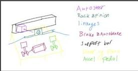
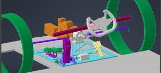
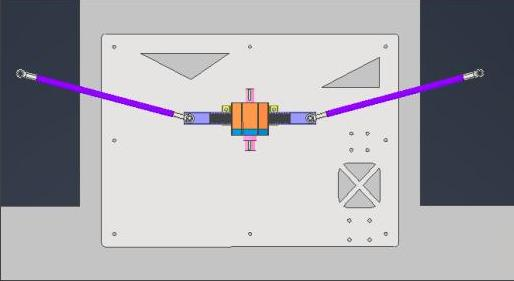
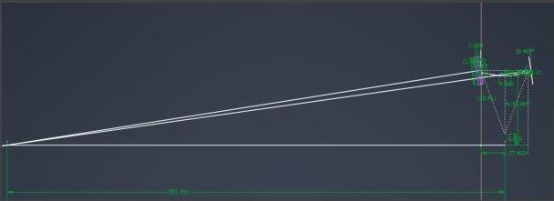
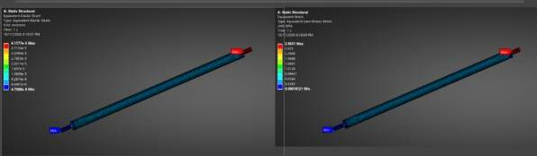
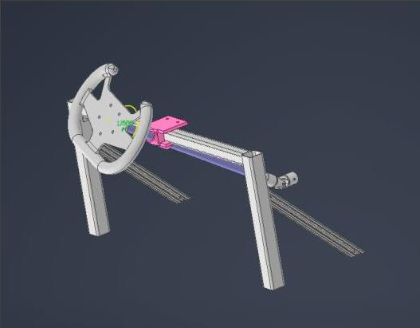
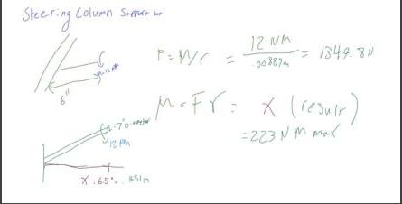
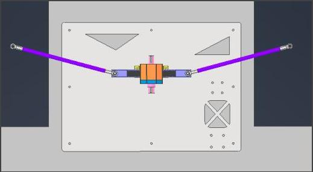

Lydia Woodall liw9@cornell.edu  
Cornell Electric Vehicles Steering Lead 26-27'

This year I have 3 main projects alongside managing interfacing and design for the steering sub-projects. These projects are all for my steering subsystem of mechanical of Cornell Electric Vehicles that designs a vehicle to compete in ShellEco Marathon. One of those projects is Steering linkages: including Ackerman calculations and FEA, Steering flat plate to allow more precise mounting connections (expanded on later) and pocketed based off mounting holes for each project and repeated Ansys modeling to check deflection under main loading conditions (bump, brake, turn) to ensure pocketing is making minimal deflection (not currently Finalized due to autobrake and acceleration pedal mounting holes changing). My last project is steering wheel supports which are being redesigned because we chose to redesign our car’s baseplate to remove wheel wells for simpler manufacturing but this removed previous connection points for steering wheel structure alongside decreasing our resistance to bending. This was redesigned to be a truss structure above the pedals which also reduces the moment arm associated with the supports from the previous design. See Sections Below for Pictures and more details.

## Steering Subsystem Geometry:

Images of overall Architecture from Preliminary Design Review: to be updated with pictures from Critical Design Review after CDR occurs.

# Linkages:

# Goals And Rules Requirements:

- Achieve close to pure ackerman geometry
- Optimize Ackermann for 10 m turning radius
- 4.5 m turning radius
- No interfacing problem with brakes and acceleration pedal
- Steering plate makes it easier and more exact hole spacing and assembly
- Two hand operation
- Steering radius <6m
- Minimal Play

# Design:

- Tie rods length of 13.27 in
- 104% Ackermann

# Ackermann Testing Master Model:

Analysis:

Ackermann Calculations:

Pure inner wheel turning Radius $R_i = \sqrt{(R - \frac{W}{2})^2 + L^2}$
$R_i = \sqrt{(6 - \frac{4.69}{2})^2 + (1.502)^2} = R_i = 9.7815 \text{ m}$

Outer Pure:

$R_0 = \sqrt{(R + \frac{W}{2})^2 + L^2}$

$R_0 = \sqrt{(10 + \frac{4.69}{2})^2 + (1.502)^2} = 10.0431 \text{ m}$

Plan inner steering angle:

$\delta_1 = \sin^{-1}(\frac{L}{R_1}) = \sin^{-1}(\frac{1.502}{9.7815})$

$\delta_0 = \sin^{-1}(\frac{L}{R_0})$

$\delta_0 = \sin^{-1}(\frac{1.502}{10.0431}) = 8.269^\circ$

$\frac{(\text{inner - outer}) \text{ actual}}{(\text{inner - outer}) \text{ ideal}} \times 100 = \text{Ackermann \%}$

$L_0 = \text{Lanken Sprague angle} = \delta_1 - \delta_0 \text{ ackermann} = 0.5830^\circ$

From Sketch: $\delta_1 = 9.08^\circ$
$\delta_0 = 8.98^\circ$

$\frac{9 - 8.98}{8.833 - 8.269} \times 100 = 110\%$ Ackermann

$(109.929\%)$

for $\delta = \frac{L}{R}$

$L = 1.502 \quad R = 4.5$

$\delta = 18.46^\circ$

$\theta_0 = 28.4^\circ + 18.46^\circ = 46.86^\circ$

$\Delta y = r \sin(46.86) - \sin(28.4)$

$\Delta y = 72.4 \text{ mm} = \underbrace{2.85 \text{ in}}_{\text{one side}}$

total needed 5.7"

Maximize ackermann for 10 m steering radius

Ensure able to achieve 4.5 m turning radius

Ackermann Steering: 110% @ 10 m -> since these Calcs is now 104% due to suspension-tiered interface being moved closer to rack and pinion due to packaging issues

Pinion Travel -> turn Radius 4.5m: (right Side Calculation)
Needed Rack Travel >= 5.7 in

Tie rod FEA:

70.62 lbf applied axially from Rack and pinion
Aluminum 6061 gives Factor of Safety of 15
Max Deformation 0.00298 mm

Steering Wheel Supports:

This design is different from previous years' designs for steering wheel supports because they were previously connected to a carbon fiber tube running between wheel wells which has been removed with our baseplate design change to remove wheel wells. Originally I wanted this new design to connect between our car's aero on the sides but after doing hand calcs we realized it would be too much force on our non load bearing aero shell. Instead we built down to our baseplate which is made of thicker carbon fiber and is designed to be load bearing. This system interfaces with the rack and pinion via U Joint.

# Analysis:

Hand Calcs: Steering Wheel Support Bar: 12 Nm steering torque to max 223 Nm max moment

# Steering Flat Plate:

More pocketing to be done after hole placements finalized (currently autosteer and autobrake holes not determined).

The purpose of the steering plate as a project is to make the hole placements for separate projects more exact as holes into the baseplate are difficult to place exactly and in previous years has been a loss of efficiency for the team. The plate is designed to be .25 in thick with all holes pressed with ¼-28 flush nuts and held up another .25 in from the baseplate by standoffs on the sides and middle of the plate.

Will run Ansys repeatedly to refine pocketing after hole placements are finalized for rest of steering projects.

## Bill of Materials for these Parts:

|  Part | Link | Sku | # packages needed | Price per package | Vendor | Status  |
| --- | --- | --- | --- | --- | --- | --- |
|  Ball Joint Ends | https://www.mcma | 60645K32 | 2 | $4.71 | McMaster | FINAL...  |
|  Tie Rod Stock | https://www.mcm | 8974K28 | 1 | $7.56 | McMaster | FINAL...  |
|  45 Degree Supports |  | 47065T188 | 2 | 53.67 | McMaster | FINAL...  |
|  Wide CF Tubes |  | 2040N16 | 1 | 213.59 | McMaster | FINAL...  |
|  Narrow CF Tube |  | 2040N14 | 2 | 73.76 | McMaster | FINAL...  |
|  L Stock For Brackets |  |  | 1 |  | McMaster | FINAL...  |
|  Steering Flat Plate |  |  | 1 |  | Send Cut Send | FINAL...  |

